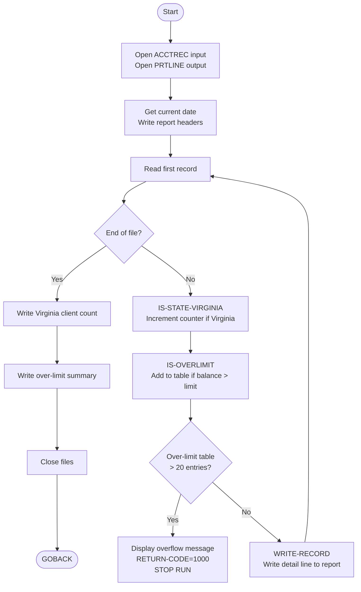

Here is the full specification for [`CBL0106C.cbl`](CBL0106C.cbl):

---

## Specification: `CBL0106C` — Financial Account Report Generator

### Overview

`CBL0106C` is a COBOL batch program that reads a sequential file of customer account records and produces a formatted printed report. For each account it lists the account number, last name, credit limit, and current balance. After processing all records it appends two summary lines: a count of clients in Virginia, and an over-limit status message.

---

### Inputs

| File DD Name | Description |
|---|---|
| `ACCTREC` | Sequential flat file of fixed-length account records (input) |

#### Account Record Layout (`ACCT-FIELDS`)

| Field | Picture | Type | Description |
|---|---|---|---|
| `ACCT-NO` | `X(8)` | Alphanumeric | Account number |
| `ACCT-LIMIT` | `S9(7)V99 COMP-3` | Packed decimal | Credit limit (up to $9,999,999.99) |
| `ACCT-BALANCE` | `S9(7)V99 COMP-3` | Packed decimal | Current balance |
| `LAST-NAME` | `X(20)` | Alphanumeric | Client last name |
| `FIRST-NAME` | `X(15)` | Alphanumeric | Client first name |
| `STREET-ADDR` | `X(25)` | Alphanumeric | Street address |
| `CITY-COUNTY` | `X(20)` | Alphanumeric | City or county |
| `USA-STATE` | `X(15)` | Alphanumeric | U.S. state name |
| `RESERVED` | `X(7)` | — | Unused/reserved bytes |
| `COMMENTS` | `X(50)` | Alphanumeric | Free-text comments |

---

### Outputs

| File DD Name | Description |
|---|---|
| `PRTLINE` | Fixed-format print file (output) |

#### Report Structure

1. **Header block** — written once at the start:
   - `"Financial Report for"` (line 1)
   - Current date: `"Year YYYY  Month MM  Day DD"` (line 2)
   - Blank separator line
   - Column headings: `Account`, `Last Name`, `Limit`, `Balance`
   - Underline row of dashes

2. **Detail lines** — one per input record:

   | Field | Format |
   |---|---|
   | Account number | `X(8)` |
   | Last name | `X(20)` |
   | Credit limit | `$$,$$$,$$9.99` (dollar-sign float) |
   | Balance | `$$,$$$,$$9.99` (dollar-sign float) |

3. **Summary lines** — written after all records:
   - Virginia client count: `"Virginia Clients = NNN"`
   - Over-limit status (see Business Rules below)

---

### Business Rules

#### 1. Virginia Client Counter
For every record where [`USA-STATE`](CBL0106C.cbl:31) equals the string `'Virginia'` exactly, the [`VIRGINIA-CLIENTS`](CBL0106C.cbl:53) counter is incremented by 1. The final count is printed at the end of the report.

#### 2. Over-Limit Detection
An account is considered **over-limit** when its balance exceeds its credit limit:

```
ACCT-LIMIT < ACCT-BALANCE
```

Over-limit accounts are collected into an in-memory table ([`OVERLIMIT`](CBL0106C.cbl:41)) that holds up to **20 entries**. Each entry stores: account limit, balance, last name, and first name. *(Note: `ACCT-NO` is not stored in the over-limit table.)*

#### 3. Over-Limit Table Overflow (Hard Abort)
If more than **20** accounts are over-limit, the program:
- Displays: `'OVERFLOW TABLE OVERLIMIT'`
- Sets `RETURN-CODE` to `1000`
- Terminates immediately via `STOP RUN`

This is a hard capacity limit — the program does not gracefully handle more than 20 over-limit accounts.

#### 4. Over-Limit Summary Line
After processing all records, the over-limit summary line is written:

| Condition | Output |
|---|---|
| Zero over-limit accounts | `"No Accounts Overlimit "` |
| One or more over-limit accounts | `"ACCOUNTS OVERLIMIT NNNN"` where `NNNN` is the count (zero-padded to 4 digits) |

---

### Processing Flow



---

### Constraints & Limitations

| Item | Value |
|---|---|
| Maximum over-limit accounts tracked | 20 |
| State filter | Virginia only (hardcoded, exact match) |
| Currency format | U.S. dollars, 2 decimal places |
| Record format | Fixed-length (`RECORDING MODE F`) |
| `ACCT-NO` not stored in over-limit table | Accounts cannot be identified by number in the summary |
